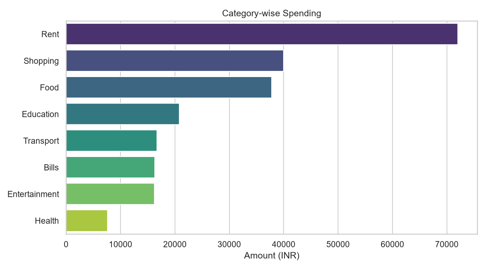
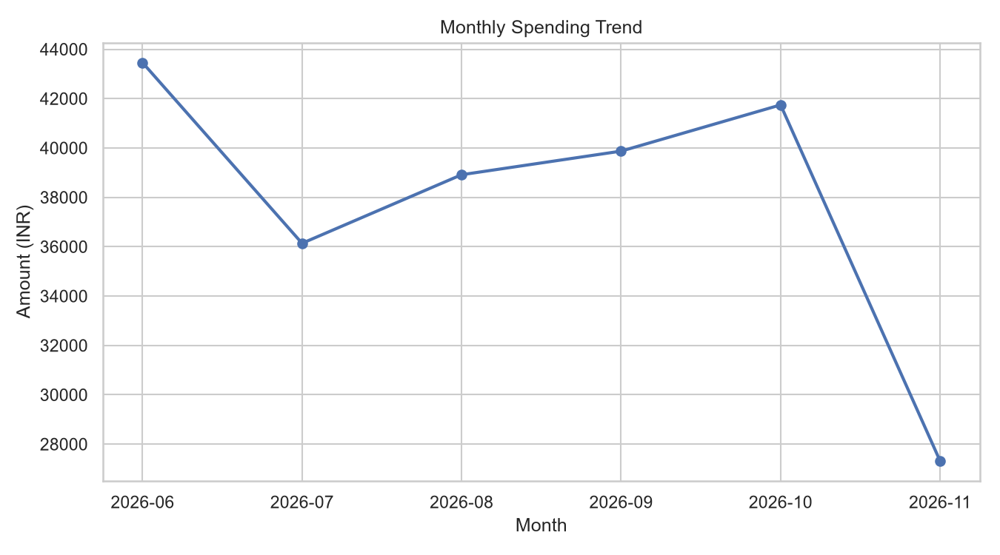
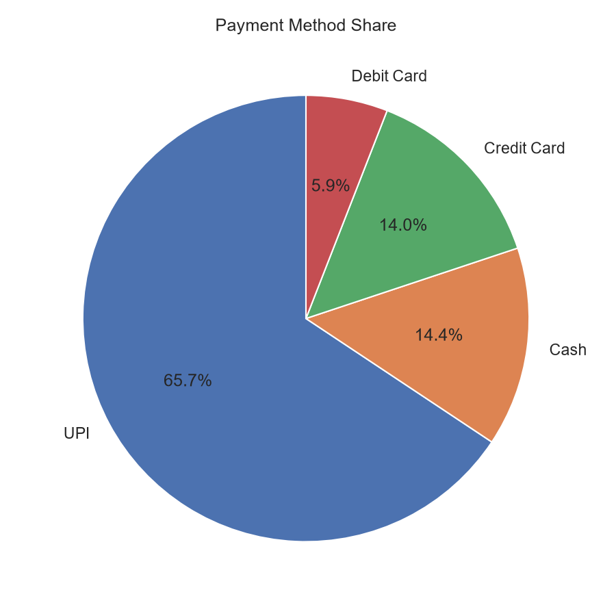
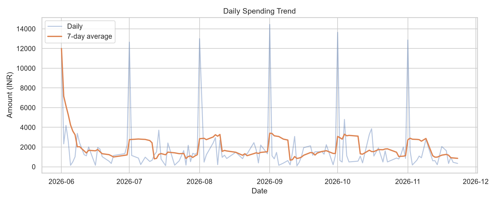

# Personal Expense Tracker with Data Visualization

A Python project that ingests expense data (CSV / manual entry / synthetic), cleans and auto-categorizes it, stores it in SQLite, analyses spending, draws charts, exports monthly reports and offers a Streamlit dashboard.

> Built with **synthetic data** only - no real banking access is used.

## Problem Statement
People rarely know where their money goes. This tool turns raw transactions into category, monthly, payment-method and budget insights so spending can be controlled and savings planned.

## Industry Relevance
Maps to real data roles: data cleaning, schema design, feature engineering (rule-based categorization), KPI calculation, dashboards and storytelling with charts. Useful for Python Developer, Data Analyst, Business Analyst and finance-automation roles.

## Features
- Synthetic dataset generator (intentionally messy: duplicates, missing values, inconsistent text)
- Data cleaning and date conversion with pandas
- Keyword-based auto-categorization
- SQLite storage
- Category, monthly, payment-method and daily analysis
- Budget vs actual check and savings rate
- 4 charts (bar, line, pie, daily trend with 7-day average)
- Text + CSV reports
- Streamlit dashboard with add-expense form

## Tech Stack
Python, Pandas, NumPy, Matplotlib, Seaborn, SQLite, Streamlit

## Folder Structure
```
Personal-Expense-Tracker-Visualization/
├── data/        raw + cleaned CSV, SQLite DB
├── notebooks/   exploration notebooks
├── src/         config, generate_data, cleaning, database, analysis, visualize, report
├── outputs/     summary CSVs
├── images/      saved charts
├── reports/     expense_report.txt
├── docs/        project guide, interview prep
├── app.py       Streamlit dashboard
├── main.py      full pipeline
├── requirements.txt
└── .gitignore
```

## How to Run
```bash
python -m venv venv
venv\Scripts\activate          # Windows
source venv/bin/activate       # Mac/Linux
pip install -r requirements.txt
python main.py                 # pipeline, charts, report
streamlit run app.py           # dashboard
```
To use your own data, replace `data/expenses_raw.csv` with columns: `date, category, amount, payment_method, note`.

## Sample Output
```
Highest spending category: Rent
Average daily spending: INR 1,292.29
Over budget in 2026-11: Education
```

## Screenshots
| Category | Monthly |
|---|---|
|  |  |
|  |  |

## Learning Outcomes
Data cleaning with pandas, groupby analysis, modular Python, SQLite basics, Matplotlib/Seaborn charts, Streamlit dashboards, Git/GitHub workflow.

## Future Improvements
Bank CSV import, ML-based categorization, recurring-expense detection, PDF reports.
